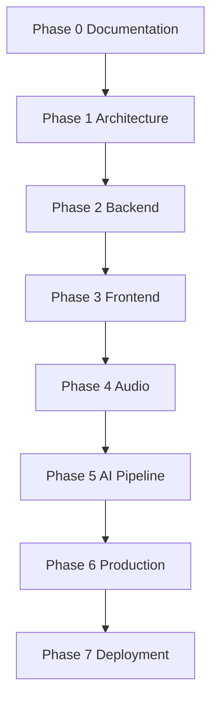

# 04 Product Roadmap

> Status: Draft. Introduced in Phase 0.

## Purpose

This document breaks development into phases, with the objective, deliverables, and exit criteria of each, so that progress can be judged objectively.

## Goals

- Order work so that each phase builds on a validated previous one.
- Define exit criteria that are observable.
- Keep the roadmap consistent with [03_Goals_and_Scope.md](03_Goals_and_Scope.md).

## Table of Contents

- [Overview](#overview)
- [Phase 0 Documentation](#phase-0-documentation)
- [Phase 1 Architecture](#phase-1-architecture)
- [Phase 2 Backend](#phase-2-backend)
- [Phase 3 Frontend](#phase-3-frontend)
- [Phase 4 Audio](#phase-4-audio)
- [Phase 5 AI Pipeline](#phase-5-ai-pipeline)
- [Phase 6 Production](#phase-6-production)
- [Phase 7 Deployment](#phase-7-deployment)
- [Open Questions](#open-questions)
- [Future Expansion Points](#future-expansion-points)
- [Related Documents](#related-documents)

## Overview

Phases are sequential by default. A phase may begin once the previous phase's exit criteria are met. Dates are not committed; the order is.

## Phase 0 Documentation

- **Objective:** Establish shared understanding and written foundations.
- **Deliverables:** The documents in this directory and the repository README.
- **Exit criteria:** Documents reviewed and approved by the owner; open decisions listed in the ADR log.

## Phase 1 Architecture

- **Objective:** Resolve open architectural decisions and finalize interfaces at the design level.
- **Deliverables:** Accepted ADRs for open decisions, finalized provider contracts, repository scaffolding conventions.
- **Exit criteria:** No open decision blocks Phase 2; [06_Project_Structure.md](06_Project_Structure.md) and [09_Low_Level_Design.md](09_Low_Level_Design.md) reflect final decisions.

## Phase 2 Backend

- **Objective:** Build the backend foundation without audio.
- **Deliverables:** Application skeleton, configuration management, session lifecycle, provider interface layer with fake implementations, persistence foundation, test harness.
- **Exit criteria:** The backend runs and is tested using fake providers only.

## Phase 3 Frontend

- **Objective:** Build the browser client foundation.
- **Deliverables:** Client application structure, session connection handling, conversation display, device selection.
- **Exit criteria:** The client establishes and ends a session with the backend.

## Phase 4 Audio

- **Objective:** Carry real-time audio between client and backend.
- **Deliverables:** Browser audio capture and playback, transport per [12_WebRTC.md](12_WebRTC.md), backend audio ingestion and emission, interruption handling at the transport level.
- **Exit criteria:** Audio round-trips between browser and backend with measured latency.

## Phase 5 AI Pipeline

- **Objective:** Connect STT, workflow orchestration, retrieval, memory, tools, LLM, and TTS.
- **Deliverables:** Real provider adapters for the initial stack, the conversation workflow, retrieval, short-term memory, tool calling foundation.
- **Exit criteria:** The MVP success criteria in [03_Goals_and_Scope.md](03_Goals_and_Scope.md) are met.

## Phase 6 Production

- **Objective:** Make the system operable and safe.
- **Deliverables:** Observability per [19_Observability.md](19_Observability.md), security measures per [21_Security.md](21_Security.md), authentication, rate limiting, failure handling.
- **Exit criteria:** Per-stage latency, token usage, and cost are visible; security checklist complete.

## Phase 7 Deployment

- **Objective:** Make the system reproducible to deploy and scale.
- **Deliverables:** Containerization, CI/CD, deployment guides, scaling approach per [20_Deployment.md](20_Deployment.md).
- **Exit criteria:** A documented deployment can be reproduced by someone other than its author.

## Open Questions

- Audio (Phase 4) precedes the AI pipeline (Phase 5). The text-based portion of the pipeline (workflow, retrieval, memory, LLM) could be validated earlier using text input, which would reduce risk. This is recorded for owner decision in Phase 1.
- Whether the initial WebRTC approach is validated by a small spike during Phase 1 rather than first appearing in Phase 4.

## Future Expansion Points

- Milestone tracking per phase once Phase 2 begins.
- Retrospectives recorded at the end of each phase.
- Post-Phase 7 work is tracked in [26_Future_Roadmap.md](26_Future_Roadmap.md).

## Related Documents

[03_Goals_and_Scope.md](03_Goals_and_Scope.md), [23_Architecture_Decisions.md](23_Architecture_Decisions.md), [26_Future_Roadmap.md](26_Future_Roadmap.md)
