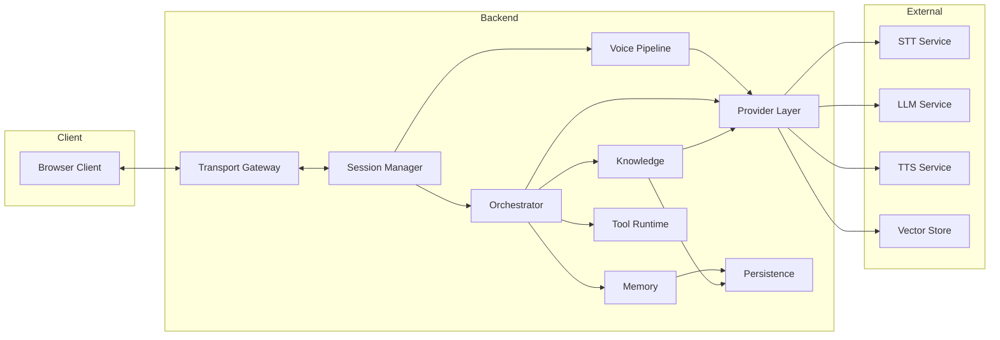

# 07 System Architecture

> Status: Draft. Introduced in Phase 0. Subject to ADR confirmation in Phase 1.

## Purpose

This document describes the overall architecture of VoiceOS: its subsystems, their responsibilities, and how they relate. Detail is deferred to [08_High_Level_Design.md](08_High_Level_Design.md) and [09_Low_Level_Design.md](09_Low_Level_Design.md).

## Goals

- Identify subsystems and assign each a single responsibility.
- Show relationships and dependency direction.
- State the architectural rules that all designs must respect.

## Table of Contents

- [Architectural Style](#architectural-style)
- [Subsystems](#subsystems)
- [Component Diagram](#component-diagram)
- [Cross-Cutting Concerns](#cross-cutting-concerns)
- [Architectural Rules](#architectural-rules)
- [Evolution Path](#evolution-path)
- [Future Expansion Points](#future-expansion-points)
- [Related Documents](#related-documents)

## Architectural Style

VoiceOS follows a layered, ports-and-adapters style. Business logic defines the capabilities it needs as contracts. Provider adapters implement those contracts. The initial deployment is a single backend process; the boundaries are drawn so that subsystems can later be separated without redesign.

## Subsystems

| Subsystem | Responsibility |
| --- | --- |
| Client | Capture and play audio, display conversation state, manage the session from the user's side |
| Transport Gateway | Terminate real-time connections, exchange audio and control events with clients |
| Session Manager | Own the lifecycle and state of a conversation session |
| Voice Pipeline | Move audio through STT and TTS, detect speech boundaries, handle interruption |
| Orchestrator | Run the conversation workflow, deciding between retrieval, tools, and response generation |
| Knowledge | Ingest documents and retrieve relevant content |
| Memory | Hold short-term and long-term conversation context |
| Tool Runtime | Register, validate, and execute tools requested by the model |
| Provider Layer | Adapt external STT, LLM, TTS, and vector store services to internal contracts |
| Persistence | Store durable data behind repository interfaces |
| Observability | Produce logs, metrics, and traces across subsystems |
| Security | Authenticate callers, enforce limits, protect secrets and data |

## Component Diagram

Observability and Security cut across all backend subsystems and are omitted from the diagram for legibility.

## Cross-Cutting Concerns

- **Observability:** every turn carries a correlation identifier through all subsystems. See [19_Observability.md](19_Observability.md).
- **Security:** authentication at the gateway, secrets handled centrally, untrusted content treated as untrusted at every stage. See [21_Security.md](21_Security.md).
- **Configuration:** one source of configuration, validated at startup.
- **Error handling:** provider errors are normalized so the rest of the system sees consistent failure categories.

## Architectural Rules

1. Business logic never imports a provider SDK.
2. Dependencies point inward; inner layers do not know outer layers exist.
3. Every external capability is reached through a contract.
4. Composition happens at one place, the composition root.
5. I/O is asynchronous; blocking work does not run on the event loop.
6. Sessions are the unit of state, and session state is not stored in module globals.
7. Every stage of a turn is measurable.

## Evolution Path

The architecture is designed so that, when needed and approved through ADRs, the following can occur without redesign: running multiple backend instances with shared session state, moving the Provider Layer or Voice Pipeline to separate processes, and replacing the Transport Gateway with a media server. See [20_Deployment.md](20_Deployment.md).

## Future Expansion Points

- Deployment topology diagrams for multi-instance operation.
- Failure-mode analysis per subsystem.
- A threat model diagram aligned with [21_Security.md](21_Security.md).

## Related Documents

[06_Project_Structure.md](06_Project_Structure.md), [08_High_Level_Design.md](08_High_Level_Design.md), [09_Low_Level_Design.md](09_Low_Level_Design.md), [11_Data_Flow.md](11_Data_Flow.md)
