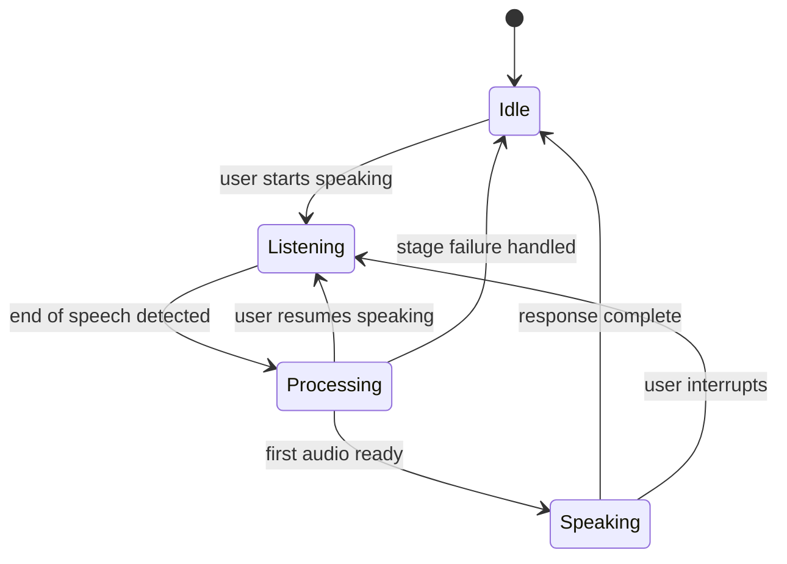

# 08 High Level Design

> Status: Draft. Introduced in Phase 0.

## Purpose

This document describes the major parts of the system, how they behave, and the design considerations that apply to each. It sits between [07_System_Architecture.md](07_System_Architecture.md) and [09_Low_Level_Design.md](09_Low_Level_Design.md).

## Goals

- Describe each major area at design level without prescribing code.
- Capture the behaviors that make real-time voice distinct from request and response systems.
- Identify the risks each area carries.

## Table of Contents

- [Frontend](#frontend)
- [Backend](#backend)
- [Voice Pipeline](#voice-pipeline)
- [AI Pipeline](#ai-pipeline)
- [Storage](#storage)
- [Streaming](#streaming)
- [External Services](#external-services)
- [Conversation Turn Lifecycle](#conversation-turn-lifecycle)
- [Key Risks](#key-risks)
- [Future Expansion Points](#future-expansion-points)
- [Related Documents](#related-documents)

## Frontend

A browser application that captures microphone audio, plays response audio, and presents session and conversation state. It is intentionally thin: it holds no provider credentials, makes no business decisions, and communicates with the backend through the protocol in [10_API_Design.md](10_API_Design.md). Responsibilities include device selection, connection status, interruption by the user, and presenting transcripts.

## Backend

An asynchronous service that terminates client connections, manages sessions, and runs the pipelines. It owns all provider interaction and all business logic. The backend is organized in layers described in [06_Project_Structure.md](06_Project_Structure.md). In the initial deployment it is a single process.

## Voice Pipeline

The part of the system concerned with audio. It receives incoming audio, determines when the user is speaking and when they have finished, supplies audio to STT, and delivers synthesized audio to the client. Its distinct concerns are:

- **Speech boundary detection:** deciding when a user has finished speaking, which directly affects perceived latency and the rate of premature cutoffs.
- **Interruption:** stopping agent speech and pending generation when the user speaks.
- **Backpressure and buffering:** keeping audio flowing when stages run at different speeds.

## AI Pipeline

The part of the system concerned with meaning. It receives transcripts, runs the conversation workflow, and produces response text. The workflow may retrieve knowledge, consult memory, call tools, and then generate a response. It is expressed as an explicit workflow so that its paths can be inspected and tested. Detail in [14_LLM.md](14_LLM.md), [15_RAG.md](15_RAG.md), [16_Memory.md](16_Memory.md), and [17_Tool_Calling.md](17_Tool_Calling.md).

## Storage

Three kinds of data are distinguished:

- **Durable application data:** sessions, conversation history, and memory, held in the relational store.
- **Knowledge data:** document content, chunks, embeddings, and the vector index.
- **Ephemeral data:** in-flight audio buffers and live session state, which do not need to survive a restart.

The initial stack uses SQLite and FAISS, each behind a repository or provider boundary.

## Streaming

Streaming is a property of the whole pipeline, not of a single stage. Audio flows continuously from client to STT; partial transcripts may flow forward; LLM output is consumed as it is produced; TTS begins before the full response exists; audio reaches the client as it is synthesized. Each handoff must support cancellation so that interruption stops downstream work. Stage behavior is detailed in [11_Data_Flow.md](11_Data_Flow.md).

## External Services

STT, LLM, TTS, and vector store services are external dependencies reached only through the Provider Layer. Each can be slow, rate-limited, or unavailable. The design assumes failure: timeouts, bounded retries where safe, and defined behavior for the user when a stage fails.

## Conversation Turn Lifecycle

## Key Risks

| Risk | Area | Mitigation direction |
| --- | --- | --- |
| Accumulated latency | Pipeline | Stage timing, streaming between stages |
| Premature cutoff or late response | Voice Pipeline | Tunable boundary detection, measured in practice |
| Provider outage | External services | Timeouts, defined degraded behavior |
| Event loop blocking | Backend | Isolate blocking work |
| State loss on restart | Storage | Clear separation of durable and ephemeral state |

## Future Expansion Points

- Quantified latency budget per stage after baseline measurement.
- Degraded-mode behaviors per provider failure.
- Multi-instance session handling, in coordination with [20_Deployment.md](20_Deployment.md).

## Related Documents

[07_System_Architecture.md](07_System_Architecture.md), [09_Low_Level_Design.md](09_Low_Level_Design.md), [11_Data_Flow.md](11_Data_Flow.md), [12_WebRTC.md](12_WebRTC.md)
