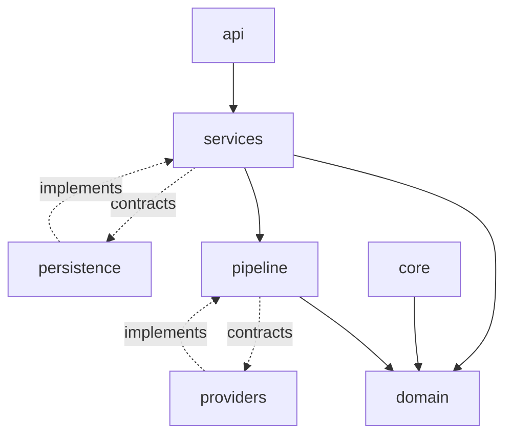

# 09 Low Level Design

> Status: Draft. Introduced in Phase 0. Contracts are described by responsibility; exact signatures are defined in Phase 1 and recorded as ADRs.

## Purpose

This document describes module responsibilities, the contracts between them, the direction of dependencies, and the provider abstraction that makes vendors replaceable.

## Goals

- Define each module's single responsibility.
- Specify contracts in terms of behavior and data, not code.
- Make dependency flow and replaceability verifiable.

## Table of Contents

- [Layers](#layers)
- [Module Responsibilities](#module-responsibilities)
- [Provider Contracts](#provider-contracts)
- [Dependency Flow](#dependency-flow)
- [Provider Abstraction](#provider-abstraction)
- [Dependency Injection and Composition](#dependency-injection-and-composition)
- [Error Model](#error-model)
- [Testing Implications](#testing-implications)
- [Future Expansion Points](#future-expansion-points)
- [Related Documents](#related-documents)

## Layers

From inside to outside: domain, services, pipeline, and the outer adapters (api, providers, persistence, observability). Inner layers define needs; outer layers satisfy them.

## Module Responsibilities

| Module | Responsibility |
| --- | --- |
| domain | Entities such as session, turn, message, and the rules governing them |
| services | Use cases that coordinate domain objects and contracts |
| pipeline | Workflow definition, stage coordination, interruption handling |
| api | Translate transport messages to service calls and back; validation |
| providers | Implement contracts for external capabilities |
| persistence | Implement repository contracts for storage |
| observability | Implement logging, metrics, and tracing contracts |
| core | Configuration, constants, shared error categories |

## Provider Contracts

Each external capability is represented by a contract owned by the inner layers. A contract is defined by what it accepts, what it yields, its streaming behavior, its cancellation behavior, and the failure categories it may report.

| Contract | Accepts | Yields | Notable concerns |
| --- | --- | --- | --- |
| Speech recognition | Audio, language hints | Interim and final transcripts | Streaming support varies by provider; segmentation strategy |
| Language model | Messages, tool definitions, generation settings | Streamed text, tool call requests, usage information | Tool call format differences; token accounting |
| Speech synthesis | Text, voice selection | Streamed audio | Sentence-level chunking; cancellation |
| Embedding | Text | Vectors | Dimensionality tied to the index |
| Vector search | Query vector, filters | Ranked chunks with metadata | Filtering and persistence differences |
| Repositories | Domain objects | Domain objects | Storage engine hidden from callers |

Contracts describe the common denominator. Provider-specific capabilities that are not common are exposed through optional capability declarations rather than by widening the contract for everyone.

## Dependency Flow

Solid arrows are compile-time dependencies. Dotted arrows show contract ownership: the contract belongs to the inner layer and the adapter implements it. No arrow points from domain to any outer layer.

## Provider Abstraction

1. The inner layer owns the contract.
2. Each provider has one adapter implementing the contract for that capability.
3. Adapters translate provider-specific requests, responses, and errors to the contract.
4. A provider is selected by configuration, not by conditional logic in business code.
5. Adding a provider means adding an adapter and a configuration option, nothing else.

The replacement criterion from [01_Project_Vision.md](01_Project_Vision.md) applies: a provider swap changes adapter code and configuration only.

## Dependency Injection and Composition

All concrete objects are assembled at one composition root at startup, based on validated configuration. Business logic receives its collaborators from outside. This keeps modules testable and prevents hidden coupling. No dependency injection framework is assumed; the need for one is evaluated only if manual composition becomes burdensome.

## Error Model

Providers raise provider-specific errors. Adapters translate them into a small set of categories understood by inner layers, such as unavailable, rate limited, invalid request, timeout, and unauthorized. The pipeline decides behavior by category, never by provider identity.

## Testing Implications

- Every contract has a fake implementation for tests.
- Adapters are verified against the contract's expected behavior.
- Tests of business logic never require network access.

## Future Expansion Points

- Finalized contract definitions recorded as ADRs in Phase 1.
- A capability declaration scheme for optional provider features.
- Contract version policy for third-party adapters.

## Related Documents

[06_Project_Structure.md](06_Project_Structure.md), [07_System_Architecture.md](07_System_Architecture.md), [22_Engineering_Principles.md](22_Engineering_Principles.md), [23_Architecture_Decisions.md](23_Architecture_Decisions.md)
