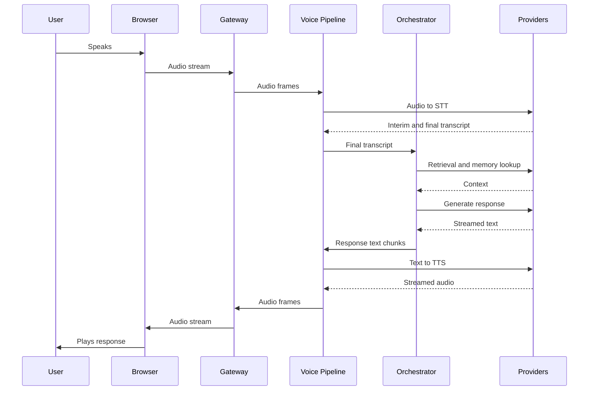

# 11 Data Flow

> Status: Draft. Introduced in Phase 0.

## Purpose

This document traces the complete path of data through one conversational turn, from microphone input to audio output, and identifies where latency, failure, and cancellation matter.

## Goals

- Describe each stage and the data passed between stages.
- Show the sequence of interactions with Mermaid diagrams.
- Define interruption and failure behavior at each stage.

## Table of Contents

- [Overview](#overview)
- [Sequence](#sequence)
- [Stage Descriptions](#stage-descriptions)
- [Interruption Flow](#interruption-flow)
- [Failure Paths](#failure-paths)
- [Latency Considerations](#latency-considerations)
- [Data Handling](#data-handling)
- [Future Expansion Points](#future-expansion-points)
- [Related Documents](#related-documents)

## Overview

```mermaid
flowchart LR
    MIC[Microphone] --> CAP[Browser capture]
    CAP --> TRN[Transport]
    TRN --> VAD[Speech boundary detection]
    VAD --> STT[Speech to text]
    STT --> WF[Workflow]
    WF --> RAG[Retrieval and memory]
    RAG --> LLM[Language model]
    LLM --> TTS[Speech synthesis]
    TTS --> TRN2[Transport]
    TRN2 --> PLAY[Browser playback]
    PLAY --> SPK[Speaker]
```

## Sequence

## Stage Descriptions

| Stage | Input | Output | Notes |
| --- | --- | --- | --- |
| Capture | Microphone signal | Encoded audio | Browser handles device access and encoding |
| Transport | Audio | Audio at the backend | See [12_WebRTC.md](12_WebRTC.md) |
| Boundary detection | Audio | Speech start and end events | Determines when the user has finished |
| STT | Audio | Interim and final transcripts | See [13_Speech_to_Text.md](13_Speech_to_Text.md) |
| Workflow | Transcript, session state | Decision on retrieval, tools, response | See [14_LLM.md](14_LLM.md) |
| Retrieval and memory | Query, session | Context passages and history | See [15_RAG.md](15_RAG.md), [16_Memory.md](16_Memory.md) |
| Tools | Tool requests | Tool results | See [17_Tool_Calling.md](17_Tool_Calling.md) |
| LLM | Assembled prompt | Streamed text | Token usage recorded |
| TTS | Text chunks | Streamed audio | See [18_Text_to_Speech.md](18_Text_to_Speech.md) |
| Playback | Audio | Sound | Client handles buffering and cancellation |

## Interruption Flow

When the user speaks during agent output:

1. The client or the boundary detector signals that the user is speaking.
2. Playback of queued agent audio stops.
3. Pending TTS synthesis is cancelled.
4. In-flight LLM generation is cancelled.
5. The session records what was actually delivered to the user, so memory reflects what the user heard.
6. The pipeline returns to listening.

Cancellation must propagate through every stage; a stage that ignores cancellation wastes cost and can speak over the user.

## Failure Paths

| Failure | Behavior to define |
| --- | --- |
| STT error or timeout | Inform the user and return to listening |
| Retrieval failure | Continue without retrieved context where safe, and record the degradation |
| LLM error or timeout | Deliver a defined fallback response and record the failure |
| Tool failure | Report failure to the workflow, which decides how to respond |
| TTS failure | Fall back to a defined behavior, such as text display |
| Transport loss | Preserve session state for a bounded reconnection window |

Exact behaviors are decided in Phase 1.

## Latency Considerations

The latency perceived by the user is the time between the end of their speech and the first audio of the response. It accumulates the time of boundary detection, final transcription, retrieval, time to the first generated tokens, time to the first synthesized audio, and transport. Streaming between stages exists to overlap these, and per-stage timing exists to make them measurable (see [19_Observability.md](19_Observability.md)).

## Data Handling

- Raw audio is processed in memory and is not persisted unless explicitly enabled.
- Transcripts and responses are persisted as conversation history, subject to retention policy in [21_Security.md](21_Security.md).
- Provider calls transmit user content to third parties when hosted providers are selected; this is documented per provider.

## Future Expansion Points

- Per-stage latency budget after baseline measurement.
- Data flow variants for text-only and telephony inputs.
- Sequence diagrams for tool calling and reconnection.

## Related Documents

[07_System_Architecture.md](07_System_Architecture.md), [08_High_Level_Design.md](08_High_Level_Design.md), [12_WebRTC.md](12_WebRTC.md), [19_Observability.md](19_Observability.md)
