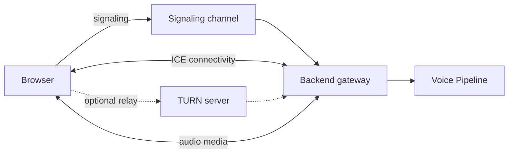

# 12 WebRTC

> Status: Draft. Introduced in Phase 0. The server-side implementation approach is an open decision for Phase 1.

## Purpose

This document explains why VoiceOS uses WebRTC for audio transport, the concepts needed to work with it, and the strategy for adopting it.

## Goals

- Justify WebRTC relative to simpler alternatives.
- Explain core concepts: ICE, STUN, TURN, and media streams.
- Define the architectural role of the transport and an adoption strategy that limits risk.

## Table of Contents

- [Why WebRTC](#why-webrtc)
- [Core Concepts](#core-concepts)
- [ICE](#ice)
- [STUN](#stun)
- [TURN](#turn)
- [Media Streams](#media-streams)
- [Architecture](#architecture)
- [Implementation Strategy](#implementation-strategy)
- [Risks](#risks)
- [Future Expansion Points](#future-expansion-points)
- [Related Documents](#related-documents)

## Why WebRTC

Voice agents need low-latency, bidirectional audio between a browser and a server. WebRTC is built for this purpose: it provides browser-native capture and playback, an audio codec suited to speech, network adaptation, echo and noise handling in the browser, and traversal of network address translation.

Audio over WebSockets is simpler to implement but runs over TCP, where packet loss causes delays that are noticeable in speech, and it leaves capture, encoding, and jitter handling to the application. WebRTC addresses these at the cost of complexity. The decision to use WebRTC is recorded as an initial stack choice; the simpler alternative remains a documented fallback.

## Core Concepts

- **Peer connection:** the object representing a connection between two endpoints. Here, the browser and the backend.
- **Signaling:** the out-of-band exchange of session descriptions and network candidates needed to establish a connection. WebRTC does not define the signaling channel; the application provides it.
- **Session description:** a description of the media each side will send and receive, exchanged as an offer and an answer.
- **Data channel:** an optional channel for non-media messages over the same connection.

## ICE

Interactive Connectivity Establishment is the procedure by which two endpoints discover a network path between them. Each endpoint gathers candidate addresses (local addresses, addresses discovered through STUN, and relay addresses obtained through TURN), exchanges them through signaling, tests pairs of candidates, and selects a working pair. ICE is specified in RFC 8445.

## STUN

STUN lets an endpoint behind a network address translator discover its public address as seen from outside. The result becomes an ICE candidate. STUN servers are lightweight and carry no media. STUN is specified in RFC 8489.

## TURN

TURN provides a relay for cases where no direct path can be established, such as restrictive firewalls or certain network address translators. Media flows through the relay, which makes TURN costly in bandwidth and a production dependency. TURN is specified in RFC 8656. Whether a backend that has a publicly reachable address needs TURN for its own side is a deployment question addressed in [20_Deployment.md](20_Deployment.md); client-side network conditions can still require it.

## Media Streams

Audio is carried as a media stream encoded with a codec that WebRTC mandates for browsers, which is suited to speech and adapts to network conditions. The browser applies its own capture processing for echo, noise, and gain, which are configurable. The backend receives encoded frames, decodes them, and passes audio to the Voice Pipeline; outgoing audio takes the reverse path. Media is encrypted in transit as part of WebRTC.

## Architecture

The Transport Gateway isolates the rest of the backend from WebRTC. Downstream components see decoded audio frames and control events and do not depend on WebRTC types, so the transport can be replaced by a WebSocket fallback or a media server.

## Implementation Strategy

1. **Define the boundary first.** Specify what the Voice Pipeline expects from a transport: audio frames in, audio frames out, and connection state events.
2. **Validate with a spike.** Before Phase 4, evaluate the backend approach with a small experiment limited to round-tripping audio, to expose complexity early.
3. **Evaluate options by criteria.** Candidates include a WebRTC library embedded in the Python backend and an external media server. Criteria: latency, operational complexity, scalability, maintenance, and fit with asyncio.
4. **Keep a fallback.** A WebSocket audio transport behind the same boundary supports development and constrained environments.
5. **Record the decision as an ADR** before Phase 4 implementation begins.

## Risks

| Risk | Consideration |
| --- | --- |
| Complexity | Signaling and network traversal are the most common sources of delay in development |
| Python media handling | Decoding and frame handling must not block the event loop |
| Network environments | Some client networks require a relay |
| Scaling | Media termination in the application process limits scaling; separation is possible through the transport boundary |

## Future Expansion Points

- Selected server-side approach and its ADR.
- Reconnection behavior and session resumption.
- Use of a data channel for control events.
- Integration with media servers and telephony, see [26_Future_Roadmap.md](26_Future_Roadmap.md).

## Related Documents

[08_High_Level_Design.md](08_High_Level_Design.md), [10_API_Design.md](10_API_Design.md), [11_Data_Flow.md](11_Data_Flow.md), [20_Deployment.md](20_Deployment.md)
