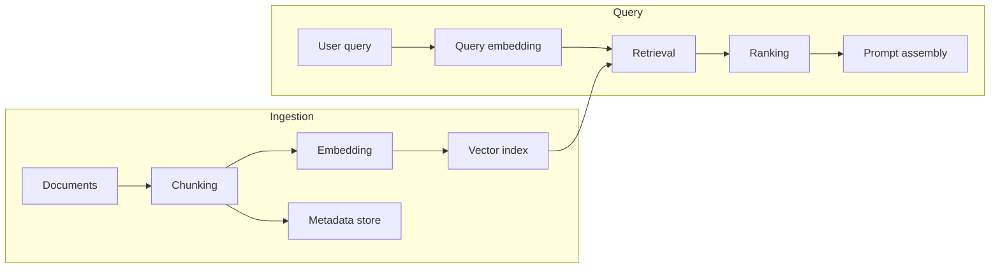

# 15 RAG

> Status: Draft. Introduced in Phase 0. Parameter values are determined by evaluation, not fixed here.

## Purpose

This document describes retrieval-augmented generation in VoiceOS: how knowledge is ingested, indexed, retrieved, ranked, and assembled into prompts.

## Goals

- Define the ingestion and query paths.
- Identify the decisions that affect quality and make them measurable.
- Account for voice-specific latency constraints.

## Table of Contents

- [Role in the System](#role-in-the-system)
- [Ingestion and Query Paths](#ingestion-and-query-paths)
- [Chunking](#chunking)
- [Embeddings](#embeddings)
- [Vector Database](#vector-database)
- [Retrieval](#retrieval)
- [Ranking](#ranking)
- [Prompt Assembly](#prompt-assembly)
- [Voice-Specific Considerations](#voice-specific-considerations)
- [Evaluation](#evaluation)
- [Security](#security)
- [Future Expansion Points](#future-expansion-points)
- [Related Documents](#related-documents)

## Role in the System

RAG supplies the language model with relevant external knowledge so that answers are grounded in the content the agent is meant to know. It belongs to the Knowledge subsystem and is invoked by the Orchestrator.

## Ingestion and Query Paths

Ingestion is offline or background work. The query path runs inside the conversation turn and is latency-sensitive.

## Chunking

Documents are divided into pieces that are individually retrievable. Considerations:

- Chunks should be coherent units of meaning, not arbitrary character spans.
- Chunk size trades precision against context: small chunks match precisely but may lose context; large chunks keep context but dilute relevance.
- Overlap preserves meaning that crosses boundaries at the cost of duplication.
- Each chunk keeps provenance: source, position, and any structure such as headings.

Strategies are compared on an evaluation set before one is adopted.

## Embeddings

Embeddings are produced by an embedding model behind its own contract. Considerations:

- The same model must embed documents and queries, and changing the model requires re-embedding the corpus.
- Embedding dimensionality is tied to the index.
- Language coverage must match the languages users speak.
- The embedding model identifier is stored with the index to detect mismatches.

## Vector Database

The initial vector search uses FAISS. FAISS provides similarity search but not metadata storage, filtering, or managed persistence, so chunk metadata is stored separately and linked to vectors by identifier, and the index is persisted and loaded explicitly. Access is through the vector search contract so that a managed or server-based store can replace it. See [05_Tech_Stack.md](05_Tech_Stack.md).

## Retrieval

The query is embedded and the nearest chunks are retrieved. In conversation, the raw transcript may be a poor query, for example a follow-up such as "what about the second one". Query rewriting using conversation context is a candidate technique, weighed against the latency of an extra model call. The number of retrieved candidates is a tunable parameter.

## Ranking

Retrieved candidates may be reordered or filtered before use:

- Similarity thresholds to avoid injecting irrelevant text.
- Metadata filters, for example by source or tenant.
- Optional reranking with a dedicated model, trading latency for relevance.

A reranking step is adopted only if evaluation shows a quality gain that justifies its latency.

## Prompt Assembly

Selected chunks are placed into the prompt in a delimited section, with their source identifiers. Rules:

- Retrieved text is data, never instructions, and is marked as such. See [21_Security.md](21_Security.md).
- A token budget limits retrieved context so latency and cost remain bounded.
- The model is instructed to answer from provided context and to say when it does not know.
- Source identifiers are retained so answers can be traced for diagnosis.

## Voice-Specific Considerations

- Retrieval adds latency inside the turn, so it is measured as its own stage.
- Answers are spoken, so retrieved content is summarized rather than recited.
- Misrecognized words in the transcript can degrade retrieval; this is a reason to evaluate end to end with spoken input.

## Evaluation

Quality is measured, not assumed: a set of representative questions with known relevant sources, retrieval relevance metrics, and answer quality review. Changes to chunking, embeddings, or ranking are accepted on evidence.

## Security

Knowledge sources are a trust boundary. Poisoned or malicious documents can attempt to manipulate the model, and multi-tenant use requires strict isolation of knowledge between tenants. See [21_Security.md](21_Security.md).

## Future Expansion Points

- Hybrid retrieval combining keyword and vector search.
- Incremental ingestion and index updates.
- Citation of sources in responses.
- Knowledge freshness and deletion handling.

## Related Documents

[05_Tech_Stack.md](05_Tech_Stack.md), [09_Low_Level_Design.md](09_Low_Level_Design.md), [14_LLM.md](14_LLM.md), [16_Memory.md](16_Memory.md), [21_Security.md](21_Security.md)
