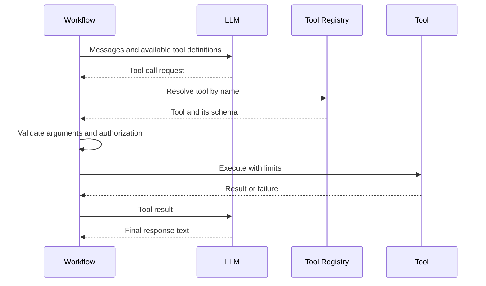

# 17 Tool Calling

> Status: Draft. Introduced in Phase 0. MCP support is evaluated in Phase 1; it is not a committed feature.

## Purpose

This document describes how VoiceOS lets agents take actions: the tool calling model, the Model Context Protocol, execution rules, and the tool registry.

## Goals

- Define a safe, predictable path from a model request to an executed action.
- Keep tool definitions independent of any model provider.
- Account for the constraints of tools in a spoken conversation.

## Table of Contents

- [Role in the System](#role-in-the-system)
- [Tool Calling Model](#tool-calling-model)
- [Tool Registry](#tool-registry)
- [Function Execution](#function-execution)
- [MCP](#mcp)
- [Safety](#safety)
- [Voice-Specific Considerations](#voice-specific-considerations)
- [Future Expansion Points](#future-expansion-points)
- [Related Documents](#related-documents)

## Role in the System

Tools let an agent look up information or perform actions beyond generating text. The Tool Runtime registers tools and executes them on behalf of the workflow. The model requests; VoiceOS decides and executes.

## Tool Calling Model

A single response may involve several tool calls in sequence. The workflow bounds the number of iterations per turn.

## Tool Registry

The registry is the single catalog of tools available to an agent. Each entry has:

- A unique name and a description written for the model.
- An argument schema used for both model guidance and validation.
- A declared side-effect level, distinguishing read-only tools from tools that change state.
- Timeout and limit settings.
- An authorization requirement.

The registry is configured per agent so that an agent sees only the tools it is allowed to use. Tool definitions use VoiceOS's own representation; adapters translate them to each model provider's format.

## Function Execution

1. Resolve the requested tool in the registry; unknown names are rejected.
2. Validate arguments against the schema; invalid arguments are returned to the model as errors, not executed.
3. Check authorization for the session and tool.
4. Execute with a timeout and with cancellation support.
5. Normalize the result or failure into a consistent shape for the model.
6. Record the call, duration, and outcome for observability.

Failures are returned to the workflow in a structured form so the model can respond sensibly rather than silently.

## MCP

The Model Context Protocol is an open protocol for connecting models to external tools and data sources through a standard interface. For VoiceOS it is a candidate mechanism for tool discovery and invocation, where tools provided by MCP servers appear in the registry like any other tool. Questions to resolve before adoption:

- How MCP-provided tools are authorized and constrained, since their descriptions and results come from outside the project.
- How timeouts and failures of remote tool servers are handled during a live conversation.
- Whether it is needed for the MVP or deferred.

Adoption requires an ADR. See [23_Architecture_Decisions.md](23_Architecture_Decisions.md).

## Safety

- Tool results are untrusted content and are delimited from instructions, as are retrieved documents. See [21_Security.md](21_Security.md).
- State-changing tools require stronger controls, such as confirmation by the user before execution.
- Tools run with the minimum privileges they need.
- Tools that may be retried are designed to be safe to repeat, or are not retried.
- Arguments that originate from model output are never used to construct commands or queries without validation.

## Voice-Specific Considerations

- A tool call that takes time creates silence. The workflow should decide whether to signal that work is in progress.
- Confirmation of consequential actions must be spoken and unambiguous, and recognition errors must not trigger an action unintentionally.
- Tool outputs are often structured; the response is a spoken summary, not a recitation.
- If the user interrupts during execution, cancellation behavior is defined per tool.

## Future Expansion Points

- Parallel tool execution.
- Tool permission scopes tied to authentication.
- Tool usage analytics and cost attribution.
- A plugin mechanism for third-party tools, see [26_Future_Roadmap.md](26_Future_Roadmap.md).

## Related Documents

[09_Low_Level_Design.md](09_Low_Level_Design.md), [14_LLM.md](14_LLM.md), [19_Observability.md](19_Observability.md), [21_Security.md](21_Security.md)
