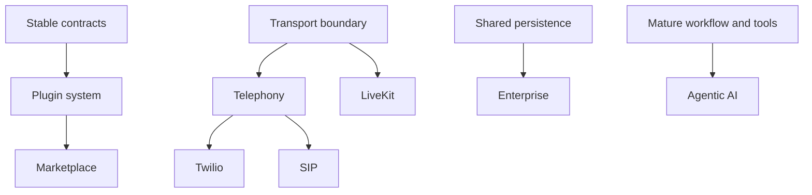

# 26 Future Roadmap

> Status: Draft. Introduced in Phase 0. Nothing in this document is committed or scheduled. Items are directions the architecture should not preclude, not planned features.

## Purpose

This document records possible directions after the phases in [04_Product_Roadmap.md](04_Product_Roadmap.md): what each would add, what it requires, and the risks it brings.

## Goals

- Keep long-term ideas visible without letting them influence MVP scope.
- State prerequisites so that each idea can be assessed realistically.
- Identify architectural implications early.

## Table of Contents

- [How Items Are Promoted](#how-items-are-promoted)
- [Plugin System](#plugin-system)
- [Marketplace](#marketplace)
- [Telephony](#telephony)
- [LiveKit](#livekit)
- [Twilio](#twilio)
- [SIP](#sip)
- [Enterprise](#enterprise)
- [Agentic AI](#agentic-ai)
- [Dependencies Between Items](#dependencies-between-items)
- [Future Expansion Points](#future-expansion-points)
- [Related Documents](#related-documents)

## How Items Are Promoted

An item moves from this document into the roadmap only through an ADR that states the need, the design, and the effect on existing architecture, and after the owner's approval. Items remain here until the foundation they depend on exists.

## Plugin System

- **What:** A defined way for third parties to add providers, tools, or workflow components without modifying the core.
- **Requires:** Stable, versioned contracts and a clear trust model for third-party code.
- **Risks:** A public extension surface constrains future change; third-party code expands the attack surface. See [21_Security.md](21_Security.md).
- **Related:** [09_Low_Level_Design.md](09_Low_Level_Design.md), [17_Tool_Calling.md](17_Tool_Calling.md).

## Marketplace

- **What:** A place to discover and share plugins and agent configurations.
- **Requires:** A plugin system, a vetting and signing approach, and governance.
- **Risks:** Moderation burden and supply chain risk. It is a community concern more than a framework feature and may live outside this repository.

## Telephony

- **What:** Letting agents handle phone calls in addition to browser sessions.
- **Requires:** A transport abstraction that admits non-browser audio sources, handling of telephone audio quality, and call lifecycle concepts such as dialing, answering, and hanging up.
- **Risks:** Lower audio quality affects recognition, and telecommunications regulation and consent requirements vary by jurisdiction.
- **Related:** [12_WebRTC.md](12_WebRTC.md), [13_Speech_to_Text.md](13_Speech_to_Text.md).

## LiveKit

- **What:** Using an open-source real-time media platform as the transport and media server layer instead of terminating WebRTC in the backend.
- **Requires:** The transport boundary defined in [12_WebRTC.md](12_WebRTC.md), and evaluation of operational complexity against the benefit.
- **Risks:** Another system to deploy and understand. It may become the preferred approach earlier than this list implies, which is why the WebRTC decision is scheduled for Phase 1.

## Twilio

- **What:** Using a communications platform as a telephony provider for phone connectivity.
- **Requires:** Telephony support and an adapter at the transport boundary.
- **Risks:** Vendor dependence, which the provider independence principle addresses by keeping it behind an adapter, and per-minute costs.

## SIP

- **What:** Direct connectivity with telephone networks and business phone systems through the Session Initiation Protocol.
- **Requires:** Telephony support, and either a media server with SIP capability or a gateway.
- **Risks:** Operational complexity, network and security configuration, and interoperability variation between systems.

## Enterprise

- **What:** Capabilities that organizations typically require: multi-tenancy, role-based access control, audit logging, single sign-on, data retention controls, and support for private deployment.
- **Requires:** Strong tenant isolation throughout knowledge, memory, and configuration, as outlined in [21_Security.md](21_Security.md), and a shared persistence layer beyond SQLite.
- **Risks:** Scope growth; enterprise requirements can dominate the design if not bounded.

## Agentic AI

- **What:** Agents that plan and carry out multi-step tasks using tools with greater autonomy, rather than responding turn by turn.
- **Requires:** A mature workflow layer, reliable tool calling, strong safety controls, and evaluation methods for multi-step behavior.
- **Risks:** Compounding errors, unintended actions, cost, and difficulty testing. In a voice setting, long-running work also requires design for what the user hears while waiting.
- **Related:** [14_LLM.md](14_LLM.md), [16_Memory.md](16_Memory.md), [17_Tool_Calling.md](17_Tool_Calling.md).

## Dependencies Between Items

## Future Expansion Points

- Estimated effort and priority once the MVP exists.
- Community input on which directions matter most.
- Retirement of items that are no longer relevant.

## Related Documents

[01_Project_Vision.md](01_Project_Vision.md), [03_Goals_and_Scope.md](03_Goals_and_Scope.md), [04_Product_Roadmap.md](04_Product_Roadmap.md), [23_Architecture_Decisions.md](23_Architecture_Decisions.md)
